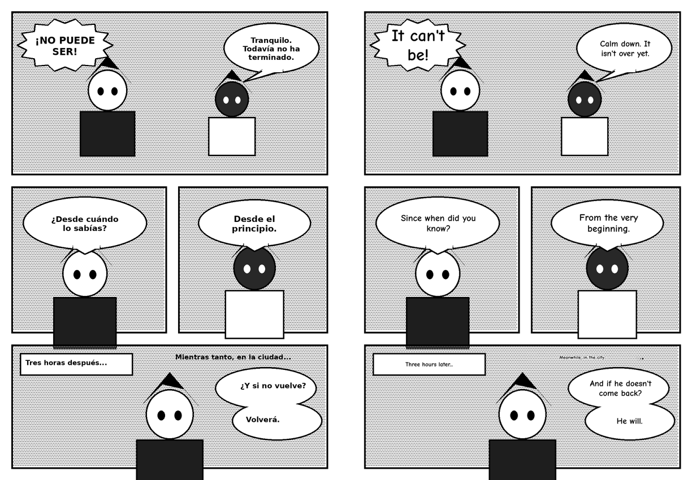
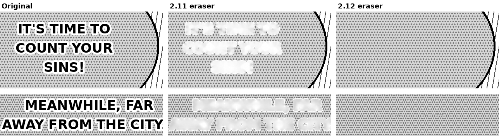

# Gytakusub

Translate manga, manhwa and comics **in place**, in your browser, with your own Claude API key.

Gytakusub finds the text and the speech bubbles on a page, asks Claude to translate it, removes the original lettering and letters the translation back into the same bubbles. It runs as a browser extension (Brave, Chrome, Edge) and as a web app for phones. There is no server and no account: your browser talks to the Claude API directly.

## Features

- **Translated in place.** Each line goes back into its own bubble, sized from the original lettering. Narration over the art stays where it was.
- **Clean erasing.** White bubbles get their own white. Screentone is continued dot for dot. Other surfaces are filled by a manga-trained inpainting model.
- **Any site you read on.** Hover a page and press Translate, press `Alt+T` for everything on screen, or let it translate as you scroll.
- **Sharp on every screen.** Drawn at your screen's own pixels and redrawn when you zoom or resize, from a phone to a large monitor.
- **Consistent across pages.** Names and recent lines carry over from page to page, and you can teach it a glossary or fix any line.
- **20 target languages**, or type any other. The interface comes in 10 of them.
- **On your phone too.** The web app translates screenshots, or a whole chapter from a link through a free fetcher you run on your own Cloudflare account.
- **Text and bubbles are found on your device**, on the graphics card when there is one. Only the page image goes to Claude.

## Install

- **Extension:** download the zip from the [latest release](https://github.com/gywreb/gytakusub/releases/latest) and unzip it somewhere permanent. Open `brave://extensions` (or `chrome://extensions`), turn on **Developer mode**, choose **Load unpacked** and pick the folder.
- **Web app:** open [gywreb.github.io/gytakusub](https://gywreb.github.io/gytakusub/) in Safari on iPhone (any browser elsewhere), then **Share → Add to Home Screen**.

## Quick start

1. A setup page opens. Agree to what is sent, paste your API key (platform.claude.com → Settings → API keys) and allow site access.
2. Open a chapter, hover a page and press **Translate**. `Alt+T` translates everything on screen.
3. To translate as you scroll, open the popup → **On this site** → **Auto-translate while scrolling**.

Every control is listed in [`extension/README.md`](extension/README.md). The web app and the chapter fetcher are in [`web/README.md`](web/README.md) and [`fetcher/README.md`](fetcher/README.md).

## Cost and privacy

You pay Anthropic per page through your own key. Options → **What translating costs** shows what each model costs you per page.

Only the page image (with numbered marks), your glossary and instructions, and the chapter's names and recent lines are sent, to `api.anthropic.com` with your key. The extension asks you to agree before it sends anything. There are no analytics and no third-party servers. [Privacy policy](https://gywreb.github.io/gytakusub/privacy.html).

Gytakusub is a reading aid for pages you are already viewing. It never downloads, hosts or redistributes them, and it is not affiliated with any publisher, reader site or Anthropic.

## More

- How it works, module by module: [`docs/ARCHITECTURE.md`](docs/ARCHITECTURE.md). Why it is built this way: [`docs/adr/`](docs/adr/).
- Development, tests and pull request rules: [`CONTRIBUTING.md`](CONTRIBUTING.md).
- Problems and questions: [GitHub Issues](https://github.com/gywreb/gytakusub/issues).
- License: GNU AGPL v3 ([`LICENSE`](LICENSE)). Bundled components and their licences: [`THIRD_PARTY.md`](THIRD_PARTY.md).
