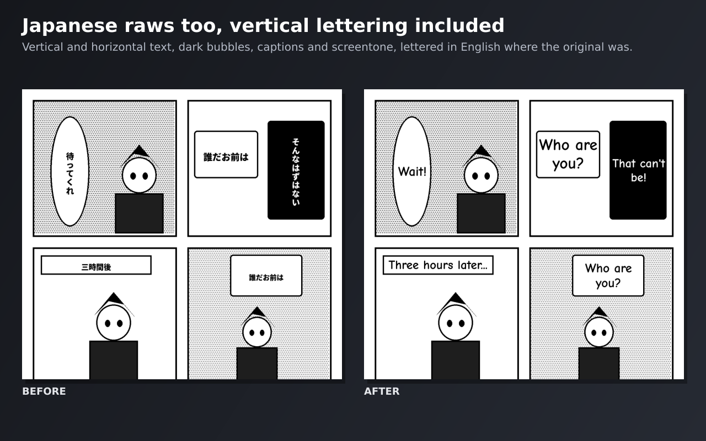
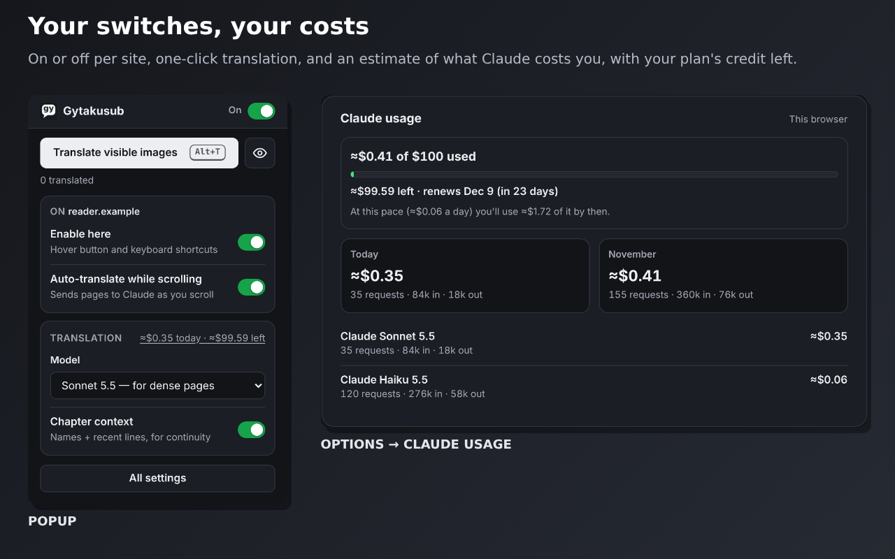
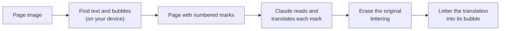

# Gytakusub

[](https://github.com/gywreb/gytakusub/actions/workflows/test.yml)
[](LICENSE)

Translate manga, manhwa and comics in place, in your browser, with your own Claude API key.


Gytakusub finds the text and the speech bubbles on a page, asks Claude to translate them, removes the original lettering and letters the translation back where it was. It runs as a browser extension (Brave, Chrome, Edge) and as a web app for phones. There is no Gytakusub server and no account: your browser talks to the Claude API directly, and you pay Anthropic only for what you translate.

## Contents

- [Features](#features)
- [Screenshots](#screenshots)
- [Install](#install)
- [Quick start](#quick-start)
- [How it works](#how-it-works)
- [How well it works](#how-well-it-works)
- [Privacy and permissions](#privacy-and-permissions)
- [Cost](#cost)
- [Limitations](#limitations)
- [Getting help](#getting-help)
- [Development](#development)
- [Contributing](#contributing)
- [Security](#security)
- [Acknowledgements](#acknowledgements)
- [License](#license)

## Features

- **Translated in place.** Each line goes back into its own bubble, set to the bubble's shape and sized from the original lettering. Narration over the art stays where it was.
- **Clean erasing.** White bubbles get their own white, screentone is continued dot for dot, and other surfaces are filled by an inpainting model trained on manga.
- **Any site you read on.** Hover a page and press **Translate**, press `Alt+T` for everything on screen, or let it translate as you scroll.
- **Sharp on every screen.** Drawn at your screen's own pixels and redrawn when you zoom or resize.
- **Consistent across pages.** Names and recent lines carry over from page to page. You can teach it a glossary or fix any line.
- **20 target languages**, or type any other. The interface comes in 10 of them.
- **On your phone too.** The web app translates screenshots, or a whole chapter from a link through a free fetcher you run on your own Cloudflare account.
- **Analysed on your device.** Text and bubbles are found in your browser, on the graphics card when there is one. Only the page image goes to Claude.


## Screenshots

| | |
|---|---|
|  |  |
| Japanese, vertical lettering included | The popup and what translating costs |

All pictures here are of test pages made for Gytakusub; no published manga is shown.

## Install

### Browser extension (Brave, Chrome, Edge 116 or later)

1. Download the zip from the [latest release](https://github.com/gywreb/gytakusub/releases/latest) and unzip it to a folder you will keep.
2. Open `brave://extensions`, `chrome://extensions` or `edge://extensions` and turn on **Developer mode**.
3. Choose **Load unpacked** and pick the folder.

To update, unzip the new release over the same folder and press the reload button on the extensions page. Your settings stay.

### Web app (iPhone, Android, desktop)

Open [gywreb.github.io/gytakusub](https://gywreb.github.io/gytakusub/). On iPhone, open it in Safari and choose **Share → Add to Home Screen**. The first page downloads the engine and its models (about 75 MB, cached afterwards), and the eraser's model comes the first time a page needs it (12 MB, or 103 MB on a graphics card). Use Wi-Fi the first time.

## Quick start

**Extension**

1. A setup page opens. Read what is sent and choose **I agree**; nothing is sent before that.
2. Paste your API key (platform.claude.com → Settings → API keys) and allow site access when your browser asks.
3. Open a chapter, hover a page and press **Translate**. `Alt+T` translates everything on screen. To translate as you scroll, open the popup → **On this site** → **Auto-translate while scrolling**.

**Web app**

1. Settings → paste your API key → **Test key** → **Save**.
2. Take a screenshot, copy it and press **Paste image** (or **Choose photos**). Tap a page to flip between the translation and the original.
3. For whole chapters from a link, the **Chapter link** tab walks you through setting up your own fetcher ([`fetcher/README.md`](fetcher/README.md)).

Every control is listed in [`extension/README.md`](extension/README.md) and [`web/README.md`](web/README.md).

## How it works



1. **Find.** A text detector (PaddleOCR) and a speech-bubble model run in your browser through ONNX Runtime and OpenCV, on the graphics card where WebGPU is available.
2. **Translate.** Claude gets the page with each piece of text numbered, and gives back the original and the translation of every line, with what kind of line it is. Sound effects and logos are left as drawn.
3. **Erase.** Each line's lettering is removed: bubbles are filled with their own white, screentone is continued, and other surfaces are inpainted (LaMa on a graphics card, AOT-GAN otherwise).
4. **Letter.** The translation is fitted to the bubble's shape, at a size taken from the original lettering, and drawn over the page at your screen's resolution.

Module by module: [`docs/ARCHITECTURE.md`](docs/ARCHITECTURE.md). Why it is built this way: [`docs/adr/`](docs/adr/).

## How well it works

The engine is measured on pages its rules were never tuned on:

- **Real pages marked by researchers:** 654 pages from all 87 books of [Manga109-s](#acknowledgements), where every line of text has been boxed by hand. Half of the books are held out: they are only ever counted, never looked at while changing the engine.
- **Generated pages in seven scripts** (Japanese, Chinese, Korean, English, Spanish, Portuguese, Vietnamese), where the exact answer is known: every glyph, every bubble's inside, every letter's size.
- **An independent text detector** that is not part of Gytakusub checks what is left on the page after erasing.

Claude's answers are simulated in these tests (from the marked boxes, moved and resized a little as Claude's are), so the numbers measure Gytakusub, not Claude's reading.

<!-- quality:start (written by `node tests/bench/report.mjs`; don't edit by hand) -->
| Measure | Result |
|---|---|
| Lines found on the page before Claude answers | 97.1% |
| Lettering the independent detector still sees after erasing | 1.7% |
| Lines set under 0.7 of the original lettering's size | 8.9% |
| Pixels changed away from any text (art damage) | 0.10% |

Real pages from the held-out books: 333 pages, 2,752 lines.
<!-- quality:end -->

Per script, per kind of text, and how each number is measured: [`docs/QUALITY.md`](docs/QUALITY.md).

## Privacy and permissions

Sent, only after you agree and only to `api.anthropic.com` with your key: the page image with its numbered marks, your glossary and instructions, and (with chapter context on) the chapter's names and recent lines. Nothing else leaves your browser. There are no analytics and no Gytakusub servers. Your key and settings are stored in your browser. [Privacy policy](https://gywreb.github.io/gytakusub/privacy.html).

The extension asks for:

| Permission | Why |
|---|---|
| `storage` | Your settings, glossary, enabled sites, API key and a local record of what translating has cost. |
| `activeTab` | Run on the current tab when you press the toolbar button or `Alt+T`, without running on every page. |
| `scripting` | Add the translator to the current tab when you ask, and to the sites you enable. |
| Access to sites (optional, asked when first needed) | Comic pages come from image servers other than the page's own, which block reading them across sites. The extension fetches only the image you asked to translate (checked to be an image, at most 25 MB). You can take the access back in Options → About. |

No code is downloaded at run time: the models and runtimes are in the package.

Gytakusub is a reading aid for pages you are already viewing. It never downloads, hosts or redistributes them, and it is not affiliated with any publisher, reader site or Anthropic.

## Cost

You pay Anthropic per page through your own key. One page is one request: the image, about 500 tokens of instructions, and a few hundred tokens of answer. Haiku is the default; Sonnet and Opus read dense or stylised pages better at a higher price. Options (or Settings in the web app) → **What translating costs** shows the cost per page for each model and what you have spent. To cap spending, set a monthly limit in the Claude Console (Billing → Spend limits).

## Limitations

- The extension runs in Chromium browsers (Brave, Chrome, Edge). On Safari and Firefox, use the web app.
- Only `` pages are handled; readers that draw pages into a `<canvas>` or a CSS background are not.
- Sound effects stay as drawn.
- Translations are set horizontally, also into Japanese and Chinese. Right-to-left languages (Arabic, Hebrew, Persian) are not lettered right yet.
- Chapter links can't be read from sites behind a login, a "checking your browser" wall, or pages built by a script. Screenshots work for those.
- The extension is large (about 190 MB unpacked) because the models are bundled.

More in [`extension/README.md`](extension/README.md#known-limitations).

## Getting help

Open an issue on [GitHub Issues](https://github.com/gywreb/gytakusub/issues): there are forms for something that doesn't work, a wording fix in your language, and ideas. Issues are public, so don't attach manga pages or debug reports there. Questions about Claude billing or API keys go to Anthropic's support.

## Development

```sh
git clone https://github.com/gywreb/gytakusub.git
cd gytakusub/tests && npm install
npm test               # unit and engine tests on generated pages
npm run test:browser   # the real extension and web app in headless Chromium against a mock Claude API
```

Load `extension/` unpacked to try your changes. The web app is `web/`, a static site. Tests, benchmarks and how to read their numbers: [`docs/TESTING.md`](docs/TESTING.md).

## Contributing

Pull requests are welcome. [`CONTRIBUTING.md`](CONTRIBUTING.md) has what a pull request needs (tests, a changelog entry, screenshots when it changes what people see). Gytakusub is maintained by [@gywreb](https://github.com/gywreb), who reviews and merges every change.

## Security

Please report security problems privately through **Security → Report a vulnerability** on this repository, not in a public issue.

## Acknowledgements

Gytakusub bundles OpenCV, ONNX Runtime, the PaddleOCR text detector, a speech-bubble model by kitsumed, inpainting models (AOT-GAN from lemon-manga-translator; LaMa fine-tuned on manga by dreMaz, exported by ogkalu), hyphenation patterns and three fonts. Each keeps its own licence: [`THIRD_PARTY.md`](THIRD_PARTY.md).

The quality measurements run on the maintainer's machine and use:

- **Manga109-s**, under its terms: no page from it is in this repository. Its authors ask that these be cited:
  - J. Baek, A. Miyai, S. Onohara, H. Ikuta, K. Aizawa. *Manga109-v2026: Revisiting Manga109 Annotations for Modern Manga Understanding.* Culture × AI Workshop at ICML 2026.
  - K. Aizawa, A. Fujimoto, A. Otsubo, T. Ogawa, Y. Matsui, K. Tsubota, H. Ikuta. *Building a Manga Dataset "Manga109" with Annotations for Multimedia Applications.* IEEE MultiMedia, 27(2), 2020.
  - Y. Matsui, K. Ito, Y. Aramaki, A. Fujimoto, T. Ogawa, T. Yamasaki, K. Aizawa. *Sketch-based Manga Retrieval using Manga109 Dataset.* Multimedia Tools and Applications, 76(20), 2017.
  - J. Baek, Y. Matsui, K. Aizawa. *COO: Comic Onomatopoeia Dataset for Recognizing Arbitrary or Truncated Texts.* ECCV 2022.
- **comic-text-and-bubble-detector** by ogkalu (RT-DETR-v2, Apache-2.0) as the independent check of what is left after erasing.

## License

[AGPL-3.0-only](LICENSE) © 2026 gywreb. Bundled components keep their own licences ([`THIRD_PARTY.md`](THIRD_PARTY.md)).
